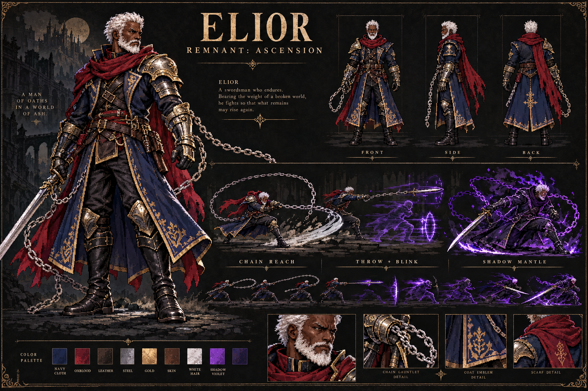

# Elior: chains, pursuit and the Boss Gauntlet

Elior is a Black human swordsman with white hair and a white beard, a navy and gold coat, oxblood scarf and chained silver weapon. View the board in Menu → Character → Character board. Original artwork was created with the built-in ImageGen tool; the board and transparent source atlas are preserved in docs/art. The sixteen-pose runtime atlas is src/assets/elior-v3.png. Its source and packing manifest remain available for future art work. The optional pack-elior.mjs authoring utility requires Sharp; the game has no new runtime dependency.

## Combat

- Selected heavy attacks, finishers, Storm, Rend and Judgment Cross extend the weapon on linked chains for 30 additional world units of reach.
- In Shadow Mantle, attacks blink into melee with a visible enemy ahead; finishers can change sides. Pursuit has a 0.55-second cooldown. Dodge grants free Phantom Steps, including before a hit.
- Press U, the controller Sub action, or the phone Throw button while transformed to throw the equipped weapon. A confirmed hit teleports to a safe spot beside the enemy and starts the second combo strike. No hearts are consumed; cooldown is 2.4 seconds.
- Misses return the weapon. Walls block throws and blinks. Placement checks the entire player body, room bounds and hazards. Ending the form or changing rooms clears the throw.
- The Mantle no longer emits sword waves on every swing. Normal high-level sword-wave progression remains. The Techniques page explains the new controls; Throw appears without a carried sub-weapon.

## Boss Gauntlet

Enter from Menu → Chapters → The Boss Gauntlet, or an altar after taking the relic. The existing survival Trial remains available.

The actual Gilded Idol, Gatekeeper, Crimson Marshal, Locust King, Image of Gold and Weigher repeat in order with their original moves, phases, intros and defeats. Ordinary summons are suppressed. Entry strength sets the initial encounter balance; health increases 22% per round, damage 10%, and tempo gradually increases to 1.5×. There is a seven-second recovery break, 20% health recovery and full energy after every victory, with loot and a Balm every six victories.

Campaign defeat flags and story callbacks are bypassed. Boss records count bosses defeated and use a separate device leaderboard, remnant.boss-board.v1. Existing save fields remain compatible; new per-save values use the flags object. Retry stays in boss mode at round 1; leaving returns to the entry room. Practice starts unlock near prior bests.

## Art briefs

Board prompt: professional landscape pixel-fantasy production board for ELIOR / REMNANT: ASCENSION. Black mature athletic human swordsman with rich dark brown skin, white hair and a full neatly shaped white beard. Navy long battle coat, oxblood scarf, gold-edged steel armor, silver sword with gauntlet chains. Hero view, front/side/back turnarounds, palette, chain reach, throw-and-blink and violet Shadow Mantle action vignettes. Transformed form remains the same human man. No franchise designs or vector placeholders.

Atlas prompt: use the approved board as a design reference and create a transparent 4 × 4 side-facing atlas with consistent identity, costume, scale and baseline. Four idle, four run, jump, fall, windup, follow-through, two evasions, hurt and throw. Empty hands; no weapons, chains, effects, labels, borders, floor or background baked into the body. Weapons and effects attach live.

## Verification

npm run build runs strict TypeScript and ten controller tests. The five update tests verify offline caching and consistent build stamps. smoke.mjs exercises production desktop/mobile rendering, foes and Echoes, movement, equipment, Mantle, existing save resume and offline startup. combat-gauntlet.mjs exercises all six boss lifecycles, a repeated cycle, stat growth, suppressed adds, campaign isolation, separate records, defeat/retry/return, pursuit, throw-hit-blink-combo, cooldown, misses, walls, chain reach, absence of Mantle waves, the character board and phone touch activation. CI runs these checks and stores screenshots. Physical iPhone/Safari and controller hardware remain device checks.
